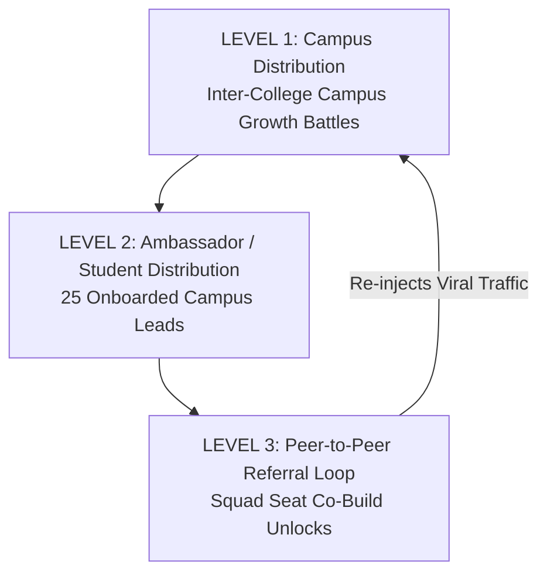

# 🚀 NxtWave Growth Challenge — 500 Signups Growth Plan (v3.0)

**Campaign Positioning:** AI Project Passport — A Product-Led Growth Engine  
**Campaign Target:** 500 TOTAL Registrations  
**Timeline:** 7 Days | **Budget:** ₹2,000 Total Campaign Budget  
**Target Audience:** Final-year B.Tech / B.E. engineering students (Batch of 2027)

---

## 1. Executive Summary & Strategic Insight

### The Bottleneck: Distribution, Not Conversion
Standard workshop growth campaigns face challenges when organizers treat conversion as the primary issue, when **distribution is the true bottleneck**. Planning assumption: generic webinar messaging (*"Attend a Free 60-Minute AI Webinar"*) may face lower student attention than a personalized project-led value proposition.

Paid digital advertising (Meta/Google Ads) targeting final-year engineering students carries an illustrative planning range of **₹80 – ₹150 per lead** (this is a planning assumption, not an observed campaign result). Spending a ₹2,000 budget on paid ads yields barely **13 to 25 registrations**, failing the 500-signup goal by over 95%.

### Core Growth Thesis: Product-Led Personalization & Squad Co-Build Loops
*"Don't sell the webinar. Sell the outcome."*

$$\text{AI Project Passport} \rightarrow \text{Match Score (0–100\%)} \rightarrow \text{Build With Me} \rightarrow \text{Squad Seat Referral} \rightarrow \text{Growth Control Room}$$

1. **AI Project Passport (60s):** Students answer 5 quick questions about their branch, coding level, and placement goals.
2. **Deterministic Recommendation Matrix:** Generates a custom AI project with an explainable **Project Match Score (0–100%)**.
3. **Build With Me (Squad Seat Hook):** *"This project is even better when you build it with a classmate."* When a student registers using a friend's referral link, **BOTH** unlock an exclusive *Proposed Team Extension Pack*. Value delivery precedes registration.

---

## 2. 500 Total Registration Model & Attribution Split

> 📌 **Important Model Note:** Referral registrations are included in the 500 total registration target; they are attribution categories within the 500 total, not additional registrations beyond 500.

```
            500 TOTAL REGISTRATION ATTRIBUTION SPLIT
┌─────────────────────────────────────────────────────────────┐
│ 🏛️ Campus Ambassadors: 200 Regs (40.0%)                    │
│ 👥 Student Referral Loop: 150 Regs (30.0%)                   │
│ 🎯 College Clubs / Communities: 100 Regs (20.0%)            │
│ 🌐 Organic Social / Direct: 50 Regs (10.0%)                  │
└─────────────────────────────────────────────────────────────┘
```

| Acquisition Source Category | Target Registrations | % of Target Model | Distribution Strategy |
| :--- | :---: | :---: | :--- |
| **Campus Ambassadors** | 200 | 40% | 25 student leads driving ~8 signups each via college WhatsApp networks. |
| **Student Referral Loop** | 150 | 30% | Peer-to-peer referral engine driven by Squad Seat co-build unlocks. |
| **College Clubs & Communities** | 100 | 20% | Tech fest partnerships, CSI/IEEE student chapters, and Telegram tech groups. |
| **Organic Social & Direct** | 50 | 10% | Student LinkedIn project pass shares, GitHub badges, and word of mouth. |
| **Total Campaign Target** | **500** | **100%** | **Modeled CAC at 500 registrations: ₹4.00 per target signup** |

---

## 3. Three-Level Growth Distribution Model



- **LEVEL 1 — Campus Distribution:** Inter-college *Campus Growth Battles* with college-specific codes (e.g., `SRM-AI27`, `VIT-AI27`) and CSI/IEEE club partnerships.
- **LEVEL 2 — Student / Ambassador Distribution:** 25 onboarded campus leads sharing branch-specific AI project passes.
- **LEVEL 3 — Peer-to-Peer Referral Loop:** Direct student-to-student sharing driven by the *"Build With Me"* Squad Seat hook.

---

## 4. Viral Coefficient ($K$) & Growth Loop Health

### Formula & Calculation
$$K = i \times c = 2.0 \times 0.25 = \mathbf{0.50}$$
Where $i$ = 2.0 average invites sent per registrant, and $c$ = 25.0% invite-to-registration conversion.

> 💡 **K < 1 Explanation:** A viral coefficient of $K = 0.50$ means every 2 registrants generate 1 additional organic registrant. Because $K < 1$, the referral loop alone does **not** sustain itself indefinitely; external acquisition channels (Ambassadors + Clubs + Organic) are required to continuously feed the loop.

### Growth Loop Health Decision Thresholds
- **Acquisition (82%):** 🟢 Healthy ($\ge 80\%$)
- **Activation (71%):** 🟡 Needs Optimization ($50-80\%$)
- **Value Delivered (80%):** 🟢 Healthy ($\ge 80\%$)
- **Sharing Rate (58%):** 🟡 Needs Optimization ($50-80\%$)
- **Referral Registration (47%):** 🔴 Critical Drop-off ($< 50\%$)

---

## 5. Segmentation Analysis ("Why Did Students Share?")

| Student Attribute Segment | Registrations | Vanity Shares | Share Rate % | Segment Insight |
| :--- | :---: | :---: | :---: | :--- |
| **Computer Science (CSE)** | 40 | 18 | **45.0%** | High ATS resume analyzer interest |
| **Electronics (ECE)** | 25 | 15 | **60.0%** | High IoT anomaly detector sharing |
| **Mechanical / Civil** | 20 | 5 | **25.0%** | Requires simpler automation hook |
| **Squad-Oriented Builders** | 30 | 21 | **70.0%** | **Top performing viral segment!** |
| **Solo-Oriented Builders** | 35 | 9 | **25.7%** | Prefers solo workshop pass |

*Potential Insight (Demo Data): Squad-oriented students show 70% share activity vs 26% for solo builders. Requires validation with real campaign traffic.*

---

## 6. Channel Decision Rules (Kill / Scale Rules)

| Channel | Metric | Threshold | Campaign Decision Action |
| :--- | :--- | :--- | :--- |
| **Campus Ambassadors** | Reg contribution | $< 50\%$ target by Day 3 | Reallocate ambassador reward pool to top student referral sprint. |
| **Referral Loop** | Invite conversion | $< 20\%$ conversion | Deploy new share message copy & test new Squad Seat incentive variant. |
| **College Clubs** | Registration volume | $< 10$ signups per club | Reduce manual outreach; reallocate effort to higher-performing communities. |
| **Organic Social** | Engagement vs signup | High clicks, low signups | Modify landing page hero headline & CTA positioning. |

---

## 7. Experiment Cards & Hypothesis Backlog

1. **Experiment 01 (CTA Messaging):** *Hypothesis:* "Students are more likely to register when CTA focuses on building with a friend." (Control: "Register for workshop", Variant: "Build this with a friend"). Primary Metric: Reg Conversion. Status: `AWAITING LIVE DATA`.
2. **Experiment 02 (Share Format):** *Hypothesis:* "Personalized project cards generate more high-quality shares than generic workshop copy." Primary Metric: Share $\rightarrow$ Reg Conversion. Status: `AWAITING LIVE DATA`.
3. **Experiment 03 (Personalization Trust):** *Hypothesis:* "Displaying the Project Match Score increases project-to-registration conversion." Primary Metric: Project $\rightarrow$ Reg Conversion. Status: `AWAITING LIVE DATA`.

---

## 8. Budget Allocation & Modeled CAC

```
BUDGET ALLOCATION HYPOTHESIS (₹2,000 TOTAL)
├── Top 3 Student Referrer Rewards Pool:  ₹1,000 (50.0%)
├── Top Campus Ambassador Cash Voucher:  ₹500  (25.0%)
└── Squad Recognition Perks & Badges:   ₹500  (25.0%)
```

- **Modeled CAC at 500 Registrations:** $\frac{₹2,000}{500 \text{ target registrations}} = \mathbf{₹4.00 \text{ per target registration}}$.
- *Planning Model — not observed campaign performance.*
